# arivu.ai

arivu.ai is a policy-gated, multi-agent incident-containment system for supply-chain traceability events. It turns an alert and recorded trace data into a defensible containment decision, checks that decision against deterministic safety controls, applies approved actions to an isolated simulator, and verifies the outcome against private evaluation data.

The project also includes a single-agent baseline so the multi-agent result can be compared on containment precision, recall, safe inventory preservation, and response time.

> **Naming note:** `arivu.ai` is the product name shown in the interface. The value `faultcore` remains in the API and internal types as the stable identifier for the multi-agent run mode. Changing it would break the shared frontend/backend contract.

## What the system does

- Visualizes product movement from ingredient lots through transformations, facilities, distribution centres, stores, inventory, and orders.
- Runs an evidence-based Investigator assessment.
- Runs an independent Reviewer assessment without exposing the Investigator's answer.
- Uses an Arbiter to resolve disagreements and commit the final lot scope.
- Allows at most one correction cycle when the Arbiter requests it.
- Applies a deterministic, fail-closed policy before any simulated action.
- Executes only approved containment actions inside fresh, per-run simulator state.
- Verifies the result using private ground truth that agents and policy code cannot access.
- Compares the multi-agent workflow with a single-agent baseline using the same policy and scoring rules.

## Architecture

```mermaid
flowchart LR
    U[Operator] --> UI[React + TypeScript UI]
    UI -->|GET scenarios and graphs| API[FastAPI]
    UI -->|POST run / poll status| API

    subgraph Runtime[Per-run orchestration]
        API --> RC[Run Coordinator]
        RC --> SM[Validated Scenario Manifest]
        SM --> TT[Read-only Trace Tools]
        TT --> AW[Agent Workflow]

        subgraph Agents[Context-isolated reasoning]
            AW --> I[Investigator]
            AW --> R[Independent Reviewer]
            I --> A[Arbiter]
            R --> A
            A -. one correction maximum .-> I
        end

        A --> SCOPE[Committed Lot Scope]
        SCOPE --> PE[Deterministic Policy Engine]
        PE -->|approved| EX[Action Executor]
        PE -->|rejected or escalation required| ES[Internal Escalation]
        EX --> SS[Isolated Simulator State]
        ES --> SS
    end

    SS --> V[Private Verification + Scoring]
    GT[(Hidden Ground Truth)] --> V
    V --> RC
    RC --> API
    API --> UI

    LLM[Groq / Gemini / OpenRouter / Mock] --> AW

    classDef private fill:#f4e8ff,stroke:#7651a8,color:#24152f;
    classDef control fill:#e8f7f2,stroke:#0d8b75,color:#0a4138;
    class GT,V private;
    class PE,EX control;
```



### Trust boundaries

1. **Agents see operational evidence only.** They never receive hidden ground truth.
2. **Reviewer isolation is enforced by application state.** The Reviewer payload is rebuilt from the immutable incident and raw trace; it does not include the Investigator output.
3. **The Arbiter decides scope but cannot execute actions.** Its structured lot IDs are expanded only through trusted manifest inventory.
4. **Policy is deterministic.** Model text cannot grant approval, create trace links, or bypass a failed check.
5. **Verification is private.** Only the scoring layer reads ground truth, after action execution.

## End-to-end process

1. **Incident selection** — the frontend requests the three canonical scenarios from `GET /api/scenarios`.
2. **Trace loading** — the selected scenario's validated public graph is returned by `GET /api/scenarios/{scenario_id}/graph`.
3. **Run creation** — the frontend posts the scenario and mode to `POST /api/runs`. The API returns a run ID immediately.
4. **Evidence collection** — read-only trace tools reconstruct recorded parents, descendants, transformations, shipments, inventory, orders, and declared gaps.
5. **Agent analysis** — in `faultcore` mode, the Investigator and blind Reviewer independently produce typed assessments. The Arbiter receives both committed outputs and selects, broadens, corrects, or escalates the scope. In `baseline` mode, one agent produces the assessment.
6. **Scope validation** — final lot IDs must be unique, known, and backed by recorded inventory positions. Unknown or empty scopes fail closed.
7. **Policy evaluation** — every proposed action passes through all deterministic checks. No individual pass can override a failure.
8. **Action execution** — approved holds and fulfilment blocks mutate only the in-memory simulator. Escalation remains non-mutating.
9. **Verification** — the private scorer checks contained affected units, missed units, safe inventory impact, dispatchable orders, and in-transit shipment exceptions.
10. **Result streaming** — the frontend polls `GET /api/runs/{run_id}` and progressively displays events, assessments, policy checks, actions, verification, and metrics.

## Agent roles

| Role | Responsibility | Context received |
| --- | --- | --- |
| Investigator | Proposes affected, possible, and excluded lots with evidence and confidence | Incident, untrusted evidence, deterministic trace |
| Reviewer | Produces an independent assessment | Incident and deterministic trace only |
| Arbiter | Resolves disagreement and commits the final scope | Trace plus committed Investigator and Reviewer outputs |
| Baseline | Provides a single-agent comparison result | Incident, untrusted evidence, deterministic trace |

All model outputs are validated against strict Pydantic schemas. Invalid output receives one structured repair attempt; a second invalid response fails the run. If a provider is unavailable, the entire reasoning attempt is discarded before the workflow moves to the next provider.

## Deterministic policy controls

Every action is evaluated against:

- action allowlist;
- prohibited behaviour;
- structured and matching lot, location, and product identifiers;
- recorded evidence paths;
- scope and target-count limits;
- human approval requirements for large or multi-region scopes;
- declared traceability gaps;
- duplicate-action protection; and
- the single correction-cycle limit.

The only permitted action types are:

- `run_trace_diagnostics`
- `place_inventory_hold`
- `block_fulfillment`
- `escalate_incident`

Publishing recall notices, disposing inventory, releasing holds, contacting suppliers, and issuing refunds are explicitly prohibited.

## Technology stack

| Layer | Technology |
| --- | --- |
| Frontend | React 19, TypeScript, Vite, TanStack Query |
| Graph visualization | React Flow (`@xyflow/react`) |
| Charts and icons | Recharts, Lucide React |
| API | FastAPI, Pydantic, Uvicorn |
| Trace graph | NetworkX |
| Agent orchestration | Explicit typed Python state machine |
| Model providers | Groq, Gemini, OpenRouter, deterministic mock |
| Testing | pytest, TypeScript compiler, Vite production build |

## Repository structure

```text
.
├── frontend/                  React application and local demo fixtures
│   └── src/
│       ├── api/               Typed HTTP client
│       ├── components/        Graph, review, comparison, and verification UI
│       ├── hooks/             Scenario, graph, connection, and run state
│       ├── mocks/             Optional frontend-only deterministic fixtures
│       ├── screens/           Incident selection and command centre
│       └── types/             Frontend API contract types
├── backend/
│   ├── agents/                Prompts, providers, trace adapter, workflow
│   ├── api/                   FastAPI routes and per-run coordinator
│   ├── models/                Shared public API contracts
│   ├── policy/                Deterministic policy engine
│   ├── scenarios/             Validated scenario manifests and graph builder
│   ├── simulator/             State, trace tools, actions, verification
│   └── tests/                 Backend integration and safety tests
├── requirements.txt           Pinned Python dependencies
└── pytest.ini                 Test configuration
```

## Canonical scenarios

These scenario IDs are fixed shared contracts across the frontend, API, tests, and manifests.

| ID | Scenario | Purpose |
| --- | --- | --- |
| `clean-trace-01` | Clean trace | Demonstrates a complete evidence chain and precise containment. |
| `over-recall-01` | Correlation over-recall trap | Tests whether the system avoids holding a safe branch linked only by a misleading recent delivery. |
| `broken-trace-01` | Broken relabelling chain | Tests fail-closed escalation when a defensible trace path cannot be reconstructed. |

## Local setup

### Prerequisites

- Python 3.11 or newer
- Node.js 20.19+ or 22.12+
- npm
- Git

### 1. Clone the repository

```bash
git clone https://github.com/meddoesdev/faulcore.git
cd faulcore
```

### 2. Create the Python environment

macOS or Linux:

```bash
python3 -m venv .venv
source .venv/bin/activate
python -m pip install --upgrade pip
python -m pip install -r requirements.txt
```

Windows PowerShell:

```powershell
py -m venv .venv
.\.venv\Scripts\Activate.ps1
python -m pip install --upgrade pip
python -m pip install -r requirements.txt
```

### 3. Configure the backend

For a fully offline, deterministic run:

macOS or Linux:

```bash
cp .env.example .env
printf '\nLLM_PROVIDER=mock\n' >> .env
```

Windows PowerShell:

```powershell
Copy-Item .env.example .env
Add-Content .env "`nLLM_PROVIDER=mock"
```

To use live models instead, copy `.env.example` to `.env`, add one or more provider keys, and leave `LLM_PROVIDER` unset. The default provider order is:

```text
Groq -> Gemini -> OpenRouter -> deterministic mock
```

Never commit `.env` or paste API keys into a run request.

### 4. Start the API

From the repository root:

```bash
python -m uvicorn backend.api.app:app --host 127.0.0.1 --port 8000 --reload
```

Confirm it is running:

```bash
curl http://127.0.0.1:8000/health
```

Expected response:

```json
{"status":"ok"}
```

### 5. Start the frontend

In a second terminal:

```bash
cd frontend
cp .env.example .env
npm ci
npm run dev
```

On Windows, replace `cp .env.example .env` with `Copy-Item .env.example .env`.

Open [http://localhost:5173](http://localhost:5173). The frontend connects to `http://localhost:8000` by default.

### Frontend-only fixture mode

If the backend is unavailable and only the interface needs to be demonstrated, set this in `frontend/.env`:

```dotenv
VITE_USE_MOCKS=true
```

Fixture mode is visually useful but does not exercise the live API, agents, policy engine, simulator, or private verifier.

## Provider configuration

| Variable | Purpose |
| --- | --- |
| `GROQ_API_KEY` | Groq credential |
| `GEMINI_API_KEY` | Gemini credential |
| `OPENROUTER_API_KEY` | OpenRouter credential |
| `GROQ_MODEL` | Optional Groq model override |
| `GEMINI_MODEL` | Optional Gemini model override |
| `OPENROUTER_MODEL` | Optional OpenRouter model override |
| `LLM_PROVIDER` | Force `groq`, `gemini`, `openrouter`, or `mock` |
| `LLM_MODEL` | Generic model override when a provider is forced |
| `LLM_API_KEY` | Generic key when a provider is forced |

Provider provenance is attached to run events without exposing credentials or raw provider error bodies.

## API reference

| Method | Endpoint | Description |
| --- | --- | --- |
| `GET` | `/health` | API readiness check |
| `GET` | `/api/scenarios` | List the three public scenarios |
| `GET` | `/api/scenarios/{scenario_id}/graph` | Return the public operational trace graph |
| `POST` | `/api/runs` | Start an asynchronous `faultcore` or `baseline` run |
| `GET` | `/api/runs/{run_id}` | Poll run status and retrieve the complete result |

Start a deterministic multi-agent run:

```bash
curl -X POST http://127.0.0.1:8000/api/runs \
  -H 'Content-Type: application/json' \
  -d '{"scenario_id":"clean-trace-01","mode":"faultcore"}'
```

The API returns `202 Accepted` with a run ID:

```json
{"run_id":"run-...","status":"running"}
```

Poll the run until its status becomes `completed` or `failed`:

```bash
curl http://127.0.0.1:8000/api/runs/run-...
```

FastAPI's interactive API documentation is available at [http://127.0.0.1:8000/docs](http://127.0.0.1:8000/docs).

## Outcome metrics

Both modes are measured by the same verifier:

- **Containment precision** — proportion of contained inventory that was actually affected.
- **Containment recall** — proportion of affected units successfully contained.
- **Safe inventory preserved** — proportion of safe inventory that remained available.
- **Under-containment rate** — affected inventory left uncontained.
- **Over-containment rate** — safe inventory unnecessarily contained.
- **Time to containment** — elapsed time only when the affected scope is fully contained; otherwise `0`.

## Testing and validation

Run the complete Python suite:

```bash
python -m pytest backend/tests backend/agents/tests -q
```

Build the production frontend:

```bash
cd frontend
npm ci
npm run build
```

The test suite covers API errors and routes, trace tools, scenario validation, policy decisions, action execution, verification, provider fallback, reviewer isolation, correction limits, run timeouts, repeated runs, reset behaviour, and hidden-ground-truth separation.

## Safety properties

- Scenario and API payloads are strictly validated; unexpected fields are rejected.
- Supplier notices, complaints, and other evidence text are treated as untrusted data.
- Agents cannot invent traceability links or use unknown identifiers as action targets.
- Reviewer context isolation is enforced and tested.
- Missing trace records and broad scopes escalate instead of silently executing.
- A failed or timed-out run cannot publish late actions.
- Each run receives fresh simulator and executor state.
- Provider failure discards partial reasoning before fallback.
- Hidden ground truth never appears in public scenario, graph, or run responses.
- No action reaches an external inventory, order, supplier, or notification system.

## Prototype limitations

- Run state is held in memory; restarting the API removes previous run IDs.
- There is no durable database, queue, authentication layer, or production authorization service.
- Human approval is represented as trusted policy context, but the public prototype API does not expose an approval endpoint.
- Containment actions affect only deterministic in-memory simulator state.
- Live provider quality and latency depend on the configured third-party service; mock mode is deterministic and offline.

## Additional documentation

- [Backend architecture and demo setup](backend/api/README.md)
- [Agent workflow](backend/agents/README.md)
- [Shared API contract](backend/models/README.md)
- [Repository ownership and development rules](AGENTS.md)

## Ownership

- Person A: `frontend/**` and `backend/agents/**`
- Person B: `backend/api/**`, `backend/policy/**`, `backend/simulator/**`, and `backend/scenarios/**`
- Shared review: `backend/models/**`, root documentation, and shared API contracts
