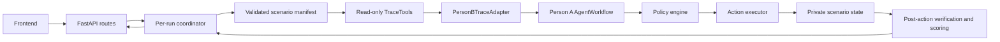

# Backend architecture and demo setup

## Run path



Each `POST /api/runs` returns a run ID immediately. The coordinator creates a
fresh simulator and action executor for that run. `GET /api/runs/{run_id}`
returns the current status, events, assessments, policy checks, actions,
verification, and metrics through the existing shared model. One provider is
used for an entire reasoning attempt; Person A's workflow controls fallback,
typed outputs, Reviewer isolation, and the single correction cycle.

The Arbiter's final lot IDs determine the FaultCore action scope. The backend
expands those IDs through recorded manifest inventory before policy checks.
An Arbiter escalation or unresolved correction executes only an internal
incident escalation. Baseline output uses its own scope and passes through the
same policy, action, and scoring layers. Supplier notices and complaints are
passed as untrusted evidence; they cannot supply approval or action targets.
The graph and agents use operational records only. Hidden ground truth is read
after actions by the private scorer and is never serialized in run, scenario,
or graph responses.

## Local demo on Windows PowerShell

Use a checkout that contains Person A's Phase 6 branch and Person B's Phase 9
or later backend work. From the repository root, install the pinned Python
requirements if they are not already installed:

```powershell
python -m pip install -r requirements.txt
```

In one terminal, select the deterministic mock provider and start the API:

```powershell
$env:LLM_PROVIDER = 'mock'
python -m uvicorn backend.api.app:app --host 127.0.0.1 --port 8000
```

In a second terminal, start the frontend:

```powershell
cd frontend
npm ci
npm run dev
```

The frontend defaults to the real API at `http://localhost:8000`. Set
`VITE_USE_MOCKS=true` only when intentionally showing its local fixtures.
The API allows development browser origins `http://localhost:5173` and
`http://127.0.0.1:5173`. Open the Vite URL, select any of the three scenarios,
and run FaultCore and baseline modes. The comparison report is available after
both modes complete.

The same flow can be checked without the frontend:

```powershell
$start = Invoke-RestMethod -Method Post -Uri http://127.0.0.1:8000/api/runs -ContentType 'application/json' -Body '{"scenario_id":"clean-trace-01","mode":"faultcore"}'
Invoke-RestMethod -Uri "http://127.0.0.1:8000/api/runs/$($start.run_id)"
```

Poll the second command until status is `completed` or `failed`.

## Provider environment

`LLM_PROVIDER=mock` runs entirely offline with a labeled deterministic
provider. With no forced provider, the agent workflow tries configured Groq,
Gemini, then OpenRouter credentials before the mock fallback. The supported
variables are `GROQ_API_KEY`, `GEMINI_API_KEY`, `OPENROUTER_API_KEY`, and optional
`GROQ_MODEL`, `GEMINI_MODEL`, `OPENROUTER_MODEL`. Person A's provider layer also
supports `LLM_PROVIDER`, `LLM_MODEL`, and `LLM_API_KEY` when a primary provider
is explicitly selected. Keep credentials in the process environment; do not
commit `.env` files or paste keys into run requests.

## Tests and limits

```powershell
python -m pytest backend/tests backend/agents/tests -q
```

- Runs and their events are held only in this API process. After a restart,
  prior run IDs return `404`; this prototype has no durable job queue.
- A timed-out run is marked failed. Its provider thread may finish later, but
  it cannot publish actions or overwrite the terminal run response.
- Broad or multi-region actions require trusted human approval. The public
  run API has no approval endpoint, so these actions escalate rather than
  executing automatically. Broken trace records also force escalation.
- Holds, fulfillment blocks, and incident escalation affect only simulated
  in-memory state. Nothing publishes a recall notice or reaches an external
  inventory or order system.
